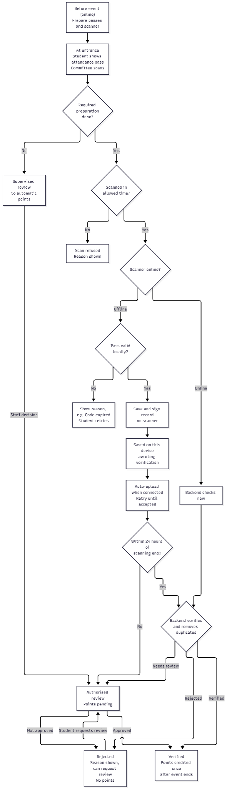
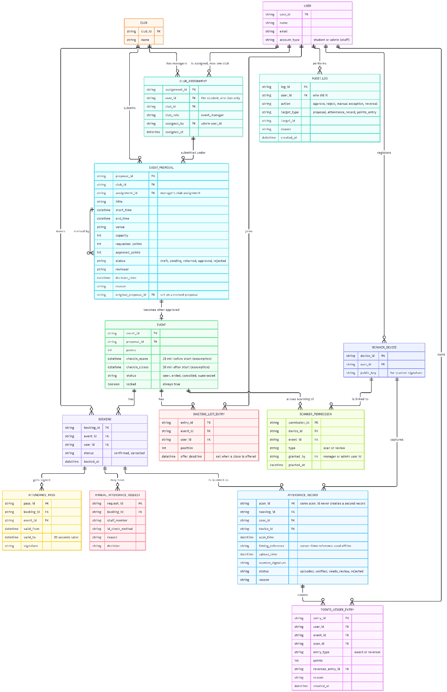
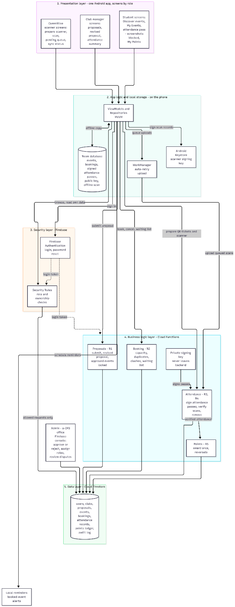

# 3. Technical Design

This section shows the system architecture, the data model and the online/offline attendance flow. The attendance security analysis (each way of cheating, how it is prevented, and the remaining weakness) is in Section 2.1 of the report.

## Diagram 1 · Attendance flow (online and offline)

Caption: R3, R4, R5. Passes and the scanner are prepared online before the event. If preparation was not done, attendance goes to supervised review with no automatic points. A scan outside the allowed check-in time is refused with a reason. An online scanner has the backend check the pass immediately. An offline scanner checks the pass locally, shows a reason if it is invalid (for example, code expired), or saves and signs the record on the device, where it waits for verification and uploads automatically when a connection returns. Records uploaded within 24 hours of scanning end are verified by the backend, which removes duplicates; later records go to authorised review. Verified attendance earns points once, after the event ends. A rejected record shows its reason and the student can request a review.

## Diagram 2 · Data model (ERD)

Caption: R1, R5, R6. An approved EVENT_PROPOSAL becomes one locked EVENT, and a revised proposal links back to the original through original_proposal_id. CLUB_ASSIGNMENT limits each event manager to one club. Each BOOKING can have signed ATTENDANCE_PASS rows (valid for 20 seconds), a MANUAL_ATTENDANCE_REQUEST and ATTENDANCE_RECORD rows. Each attendance record has a unique scan_id, the scanner's signature and a server-time reference for offline scans. SCANNER_DEVICE stores each registered scanner's public key, and SCANNER_PERMISSION grants scan or review rights per event. POINTS_LEDGER_ENTRY records awards and reversals (a reversal points to the entry it reverses), so the points history is never deleted. AUDIT_LOG records approvals, rejections, manual exceptions and reversals.

## Diagram 3 · System architecture

Caption: R1–R6. One Android app shows screens by role (student, club manager, committee scanner). ViewModels and repositories (MVVM) keep an offline copy in a Room database, queue uploads with WorkManager, and sign offline scan records with a key held in the Android Keystore. Firebase Authentication handles sign-in, and Firestore Security Rules check role and ownership on every request. Cloud Functions hold the business logic: proposals (R1), booking with capacity, duplicate and clash checks (R2), attendance pass signing and scan verification with a private key that never leaves the backend (R3, R4), and points awarded once with reversals (R5). Cloud Firestore stores all shared data. The s-CPD office approves proposals and assigns roles in the Firebase console. Event reminders are scheduled locally on the phone.
