# 4. User Interface Design

Low-fidelity wireflows for the student, club event manager, committee scanner and authorised reviewer. Admin approves or rejects proposals directly in the backend database, so there are no Admin app screens.

Figures are grouped by role: Figure 01 is the legend, Figures 02–16 are student screens, Figures 17–25 are club event manager screens, Figures 26–30 are committee scanner screens and Figures 31–32 are authorised reviewer screens. Click an image to view it at full size.

Story IDs in the captions (for example S3, C4, A1) refer to the user stories in [Requirements Analysis](requirements-analysis.md); screen codes (for example S03, C02) name the wireframe screens.

| Figure | Role | Panel | Title | Requirement | Image |
| --- | --- | --- | --- | --- | --- |
| 01 | Legend | Legend | Legend | - | [Figure 01](wireframes/images/01-legend.png) |
| 02 | Student | S01 | University sign in: failed attempt, then success | R6 | [Figure 02](wireframes/images/02-S01-sign-in.png) |
| 03 | Student | S02.01 | Discover events: filter or view an event | R2 | [Figure 03](wireframes/images/03-S02.01-discover-filter.png) |
| 04 | Student | S02.02 | Discover events: no results for a search | R2 | [Figure 04](wireframes/images/04-S02.02-no-results.png) |
| 05 | Student | S03 | Book a place on Event details - Available | R2 | [Figure 05](wireframes/images/05-S03-event-details-booking.png) |
| 06 | Student | S04 | Booking clash | R2 | [Figure 06](wireframes/images/06-S04-booking-clash.png) |
| 07 | Student | S05 | Cancel booking | R2 | [Figure 07](wireframes/images/07-S05-cancel-booking.png) |
| 08 | Student | S06 | Event details - Join Waiting List | R2 | [Figure 08](wireframes/images/08-S06-join-waiting-list.png) |
| 09 | Student | S07 | Accept the offer: place confirmed, or clash | R2 | [Figure 09](wireframes/images/09-S07-accept-offer.png) |
| 10 | Student | S08.01 | Download the attendance pass: online or offline | R3 R4 | [Figure 10](wireframes/images/10-S08.01-download-attendance-pass.png) |
| 11 | Student | S08.02 | Open the attendance pass | R3 R4 | [Figure 11](wireframes/images/11-S08.02-open-attendance-pass.png) |
| 12 | Student | S08.03 | Attendance pass - Rotation Time | R3 R4 | [Figure 12](wireframes/images/12-S08.03-qr-rotation.png) |
| 13 | Student | S09.01 | My SCPD points | R5 | [Figure 13](wireframes/images/13-S09.01-my-points.png) |
| 14 | Student | S09.02 | Attendance status - Outcomes after scanning | R4 R5 | [Figure 14](wireframes/images/14-S09.02-attendance-status.png) |
| 15 | Student | S10 | Notifications | own feature 1 | [Figure 15](wireframes/images/15-S10-reminder-notification.png) |
| 16 | Student | S11 | Notification preferences | own feature 1 | [Figure 16](wireframes/images/16-S11-reminder-preferences.png) |
| 17 | Club event manager | M01 | Profile & settings | R6 | [Figure 17](wireframes/images/17-M01-role-based-entry.png) |
| 18 | Club event manager | M02 | Manage events | R1 (approved events are locked) | [Figure 18](wireframes/images/18-M02-approved-event-locked.png) |
| 19 | Club event manager | M03 | Fill Basic event details | R1 | [Figure 19](wireframes/images/19-M03-create-event-details.png) |
| 20 | Club event manager | M04 | Review submission | R1 | [Figure 20](wireframes/images/20-M04-review-submission.png) |
| 21 | Club event manager | M05.01 | Proposal status | R1 | [Figure 21](wireframes/images/21-M05.01-proposal-status.png) |
| 22 | Club event manager | M05.02 | Proposal status | R1 | [Figure 22](wireframes/images/22-M05.02-proposal-rejected.png) |
| 23 | Club event manager | M06 | Club analytics | own feature 2 | [Figure 23](wireframes/images/23-M06-club-analytics.png) |
| 24 | Club event manager | M07 | Request event change | R1 | [Figure 24](wireframes/images/24-M07-request-event-change.png) |
| 25 | Club event manager | M08 | Manage event team | R6 | [Figure 25](wireframes/images/25-M08-manage-event-team.png) |
| 26 | Committee scanner | C01 | Scanner | R4 | [Figure 26](wireframes/images/26-C01-enable-offline-scanning.png) |
| 27 | Committee scanner | C02 | Scan attendance - Online | R3 | [Figure 27](wireframes/images/27-C02-online-scanning.png) |
| 28 | Committee scanner | C03 | Scan attendance - Offline | R4 | [Figure 28](wireframes/images/28-C03-offline-scanning.png) |
| 29 | Committee scanner | C04 | Request manual attendance review | R3 R4 | [Figure 29](wireframes/images/29-C04-manual-attendance-request.png) |
| 30 | Committee scanner | C05 | Pending uploads | R4 R5 | [Figure 30](wireframes/images/30-C05-pending-uploads.png) |
| 31 | Authorised reviewer | R01 | Requests for review | R5 R6 | [Figure 31](wireframes/images/31-R01-requests-for-review.png) |
| 32 | Authorised reviewer | R02 | Review request | R5 R6 | [Figure 32](wireframes/images/32-R02-review-request.png) |

## Legend (Figure 01)

### Figure 01 · Legend · Legend

Caption: Key to the wireflows: arrow types, grey role labels, locked approved events, the points rule and the offline rule that the figures follow (R1, R4, R5).

## Student (Figures 02–16)

### Figure 02 · S01 · University sign in: failed attempt, then success

[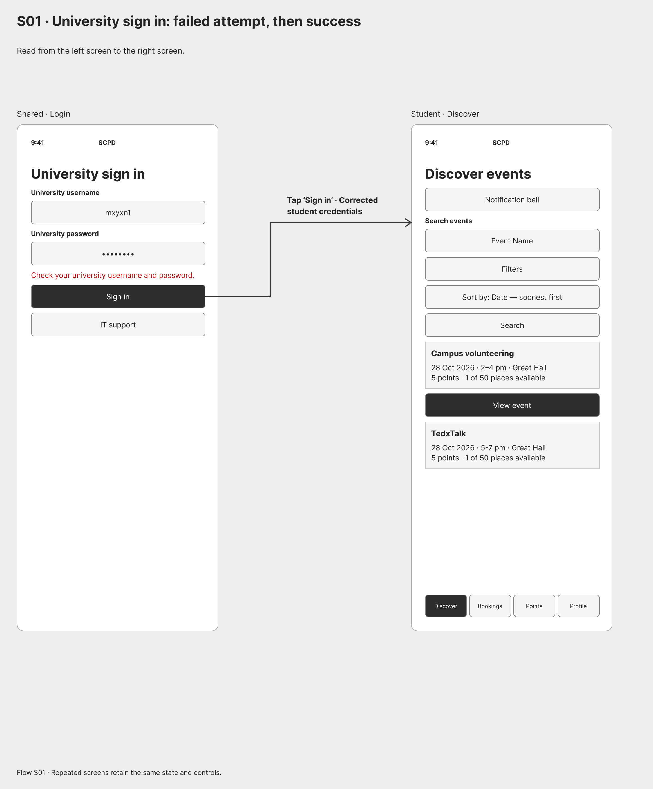](wireframes/images/02-S01-sign-in.png)

Caption: R6 (S1): A student signs in with a university account and reaches Discover events, while an incorrect username or password shows an error on the sign-in screen.

### Figure 03 · S02.01 · Discover events: filter or view an event

Caption: R2 (S2): On Discover events a student searches, filters by date or club/society name or availability, or opens an event to see its details and the places left.

### Figure 04 · S02.02 · Discover events: no results for a search

[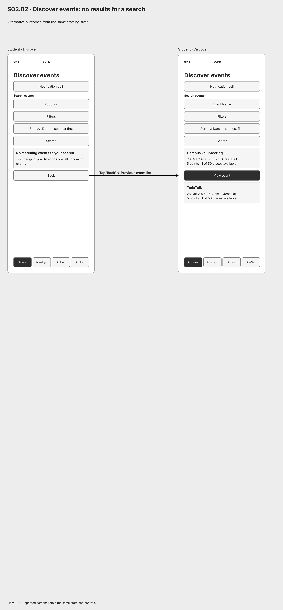](wireframes/images/04-S02.02-no-results.png)

Caption: R2 (S2): When a search matches no event, the student sees a clear "no matching events" message and a way back to the event list.

### Figure 05 · S03 · Book a place on Event details - Available

[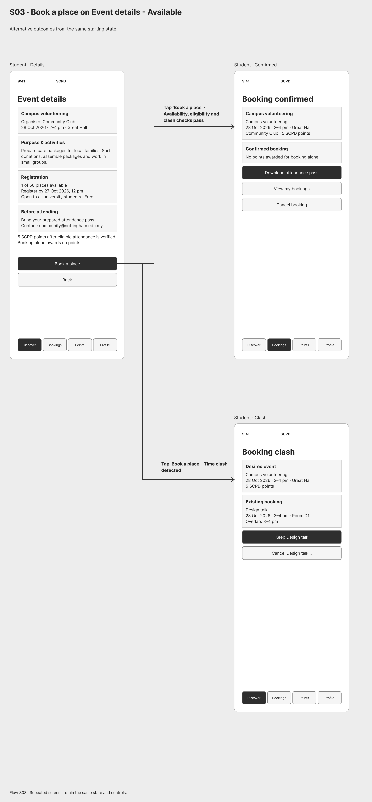](wireframes/images/05-S03-event-details-booking.png)

Caption: R2 (S3, S5): Tapping Book a place confirms the booking immediately, or stops with a booking-clash screen when another booking overlaps.

### Figure 06 · S04 · Booking clash

[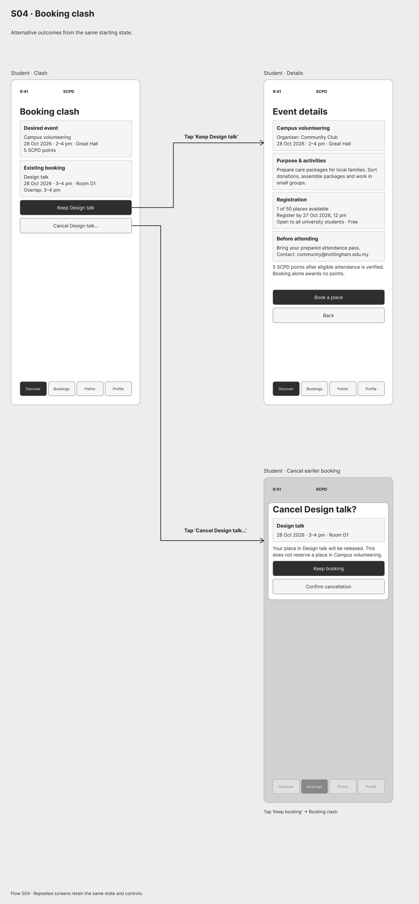](wireframes/images/06-S04-booking-clash.png)

Caption: R2 (S5, S6): A booking clash names the overlapping event and lets the student keep it or cancel it, after a confirmation, before booking the new one.

### Figure 07 · S05 · Cancel booking

[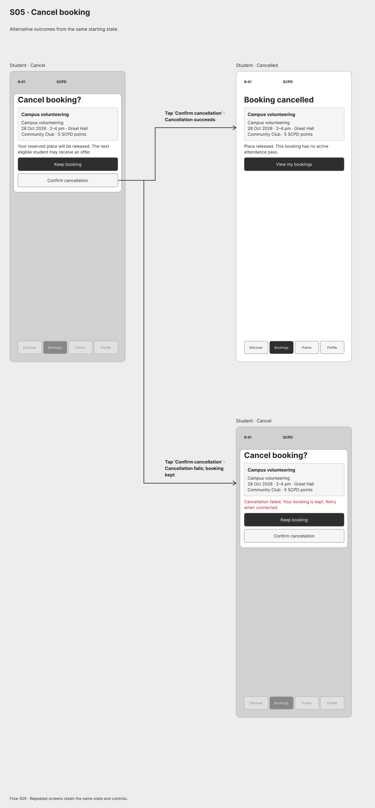](wireframes/images/07-S05-cancel-booking.png)

Caption: R2 (S6): Cancelling a booking asks for confirmation, releases the place on success, and keeps the booking with a retry message if cancellation fails.

### Figure 08 · S06 · Event details - Join Waiting List

[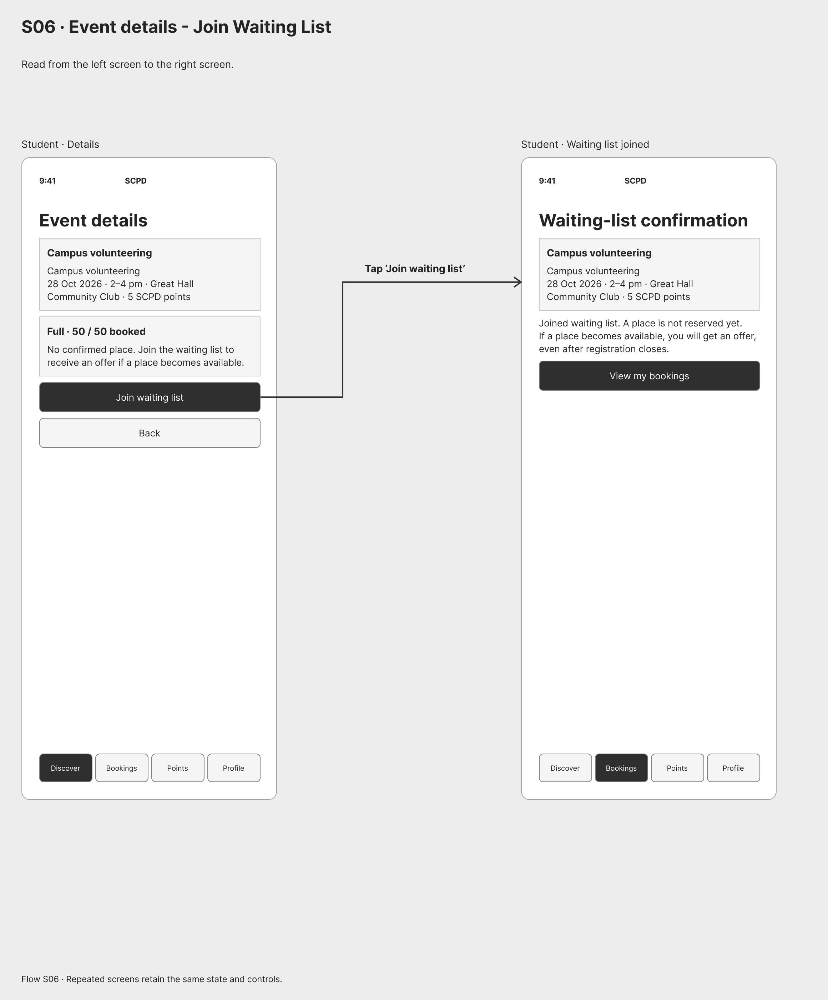](wireframes/images/08-S06-join-waiting-list.png)

Caption: R2 (S4, S12): A full event shows that no place is available and offers a waiting list that is clearly not a booking.

### Figure 09 · S07 · Accept the offer: place confirmed, or clash

[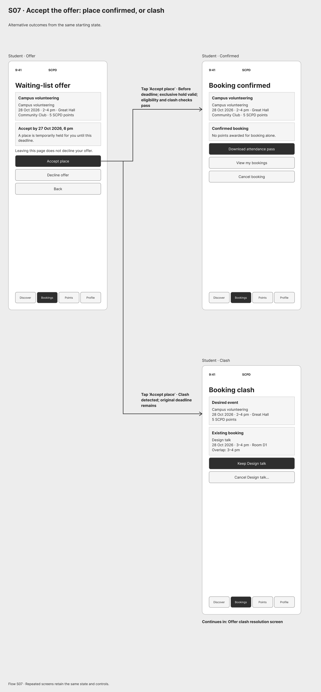](wireframes/images/09-S07-accept-offer.png)

Caption: R2 (S12): A student offered a freed place accepts before the deadline, which confirms the booking or catches a clash, and leaving the page does not decline the offer.

### Figure 10 · S08.01 · Download the attendance pass: online or offline

[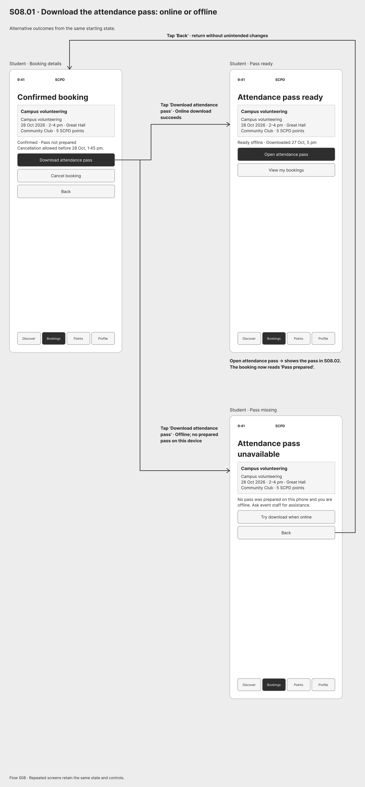](wireframes/images/10-S08.01-download-attendance-pass.png)

Caption: R3, R4 (S7, S9): While online the student downloads the attendance pass so it can be shown offline, and with no connection and no prepared pass a clear "pass unavailable" screen explains what to do next.

### Figure 11 · S08.02 · Open the attendance pass

[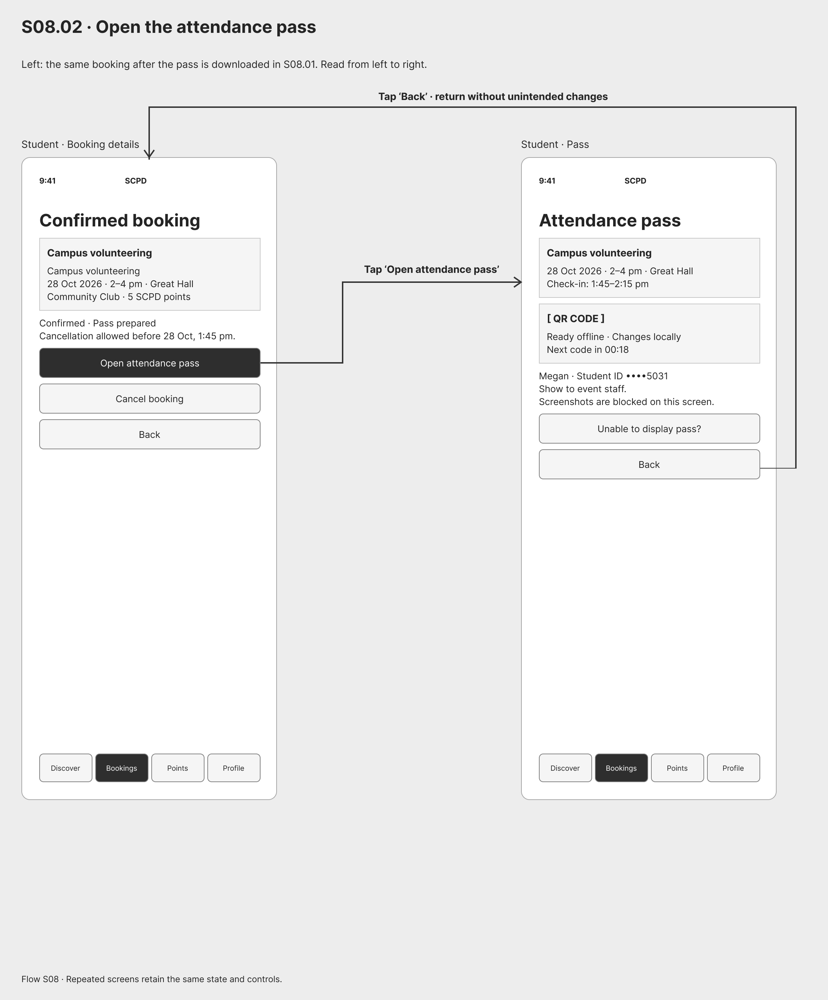](wireframes/images/11-S08.02-open-attendance-pass.png)

Caption: R3 (S7): At the event the student opens the attendance pass, which shows a time-limited QR code, a masked student ID and a screenshot block from the student phone screen.

### Figure 12 · S08.03 · Attendance pass - Rotation Time

[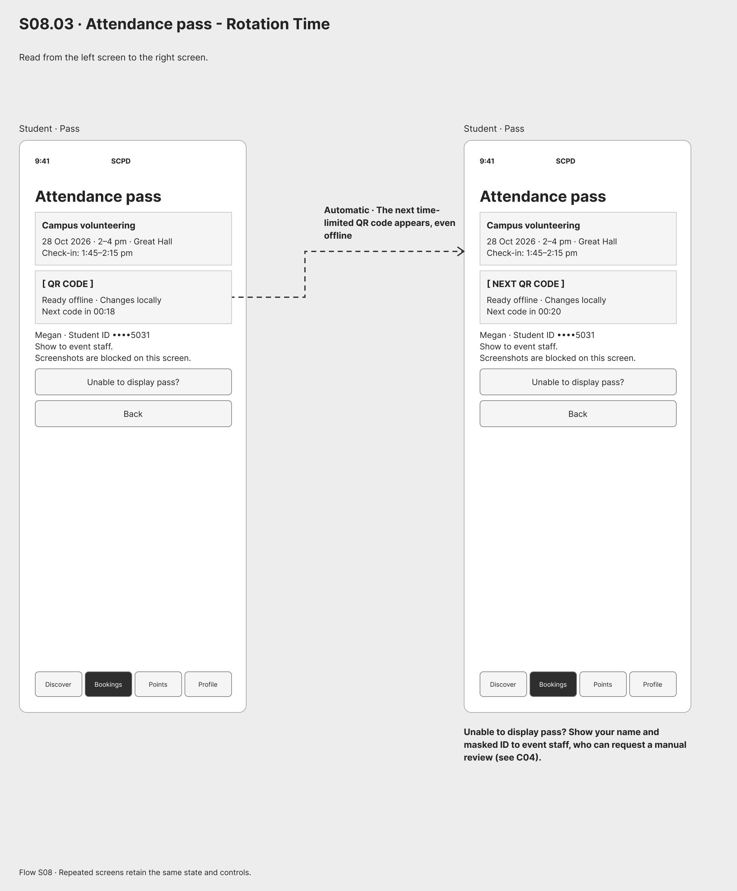](wireframes/images/12-S08.03-qr-rotation.png)

Caption: R3, R4 (S7, S8, S9): The pass QR code changes by itself on the phone, even offline, so an old code or screenshot cannot be reused.

### Figure 13 · S09.01 · My SCPD points

[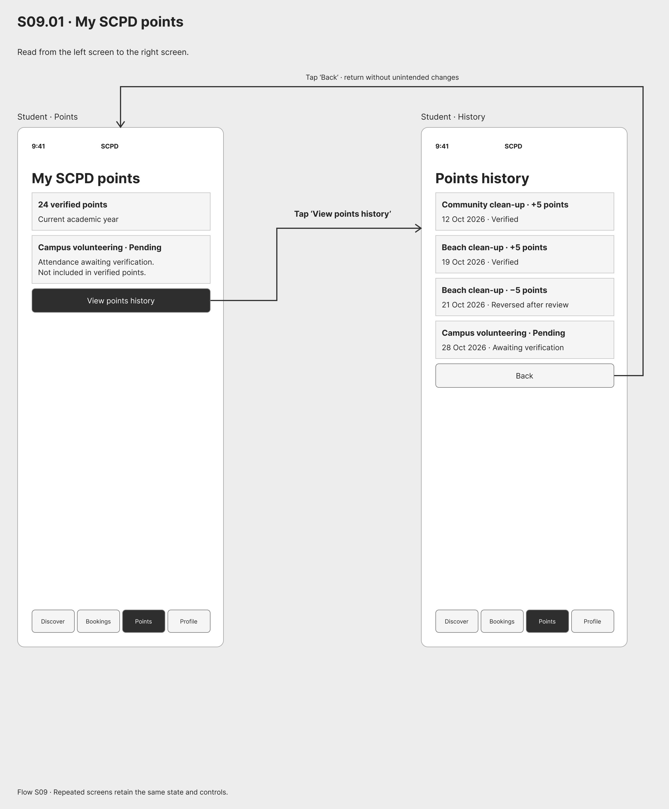](wireframes/images/13-S09.01-my-points.png)

Caption: R5 (S11, A3): My SCPD points shows verified points with a history in which each credit appears once, a wrongly awarded credit appears as a reversal, and pending attendance stays out of the total.

### Figure 14 · S09.02 · Attendance status - Outcomes after scanning

[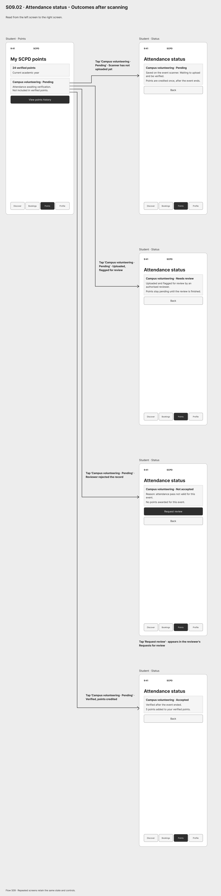](wireframes/images/14-S09.02-attendance-status.png)

Caption: R4, R5 (S10, S11): After scanning, the student sees the record's status: pending upload, needs review, accepted with points added, or not accepted with a reason and a request-review option.

### Figure 15 · S10 · Notifications

[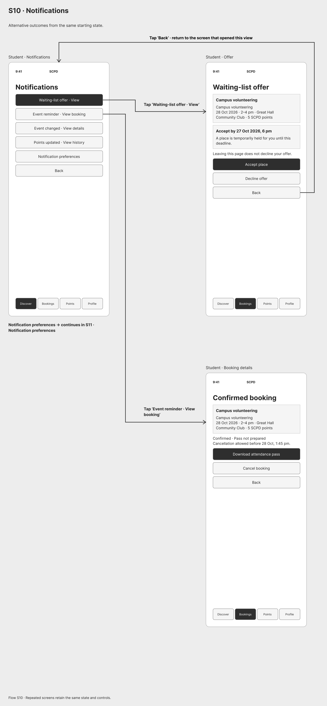](wireframes/images/15-S10-reminder-notification.png)

Caption: Own feature 1 (S13, S12, S14): The notifications list gathers event reminders, waiting-list offers, event changes and points updates, and each item opens the relevant screen.

### Figure 16 · S11 · Notification preferences

[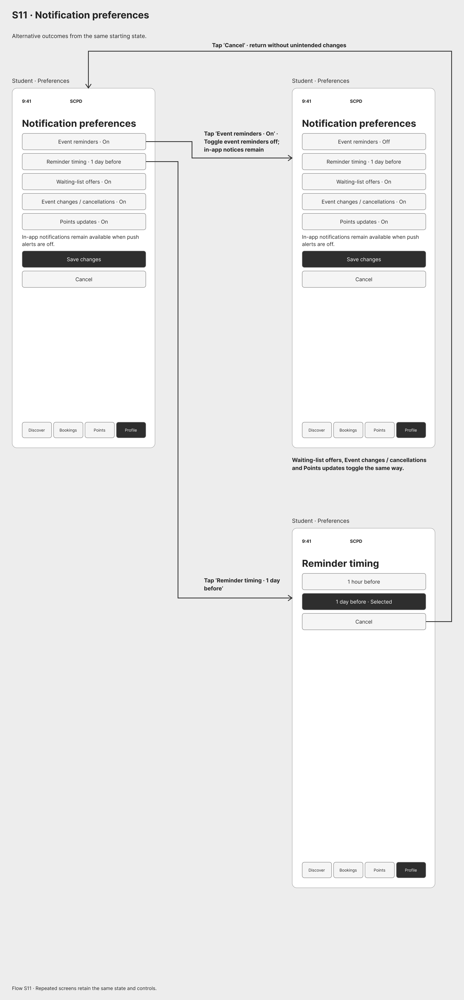](wireframes/images/16-S11-reminder-preferences.png)

Caption: Own feature 1 (S13): Notification preferences let the student switch reminders and alerts on or off and choose when reminders arrive.

## Club event manager (Figures 17–25)

### Figure 17 · M01 · Profile & settings

[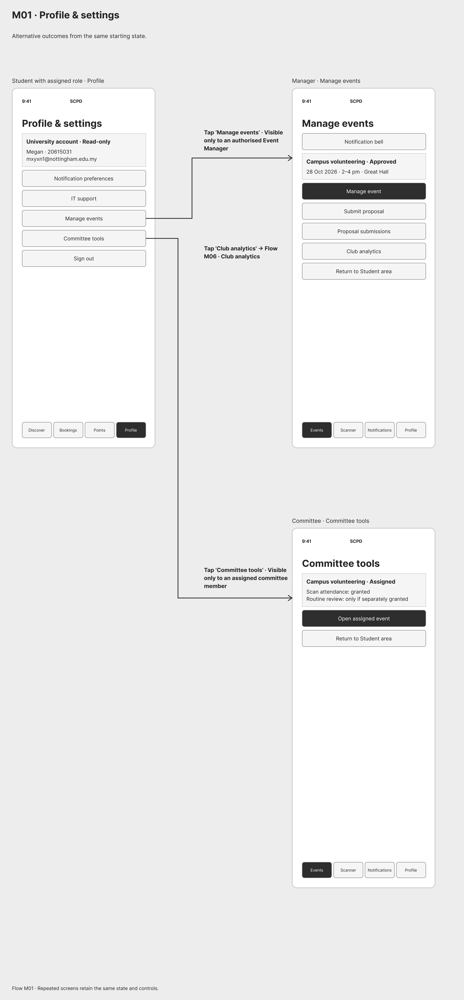](wireframes/images/17-M01-role-based-entry.png)

Caption: R6 (S1, C3, A2): The profile shows only the tools the user's role allows, with Manage events for authorised event managers, Committee tools for assigned committee members, and read-only university account details.

### Figure 18 · M02 · Manage events

[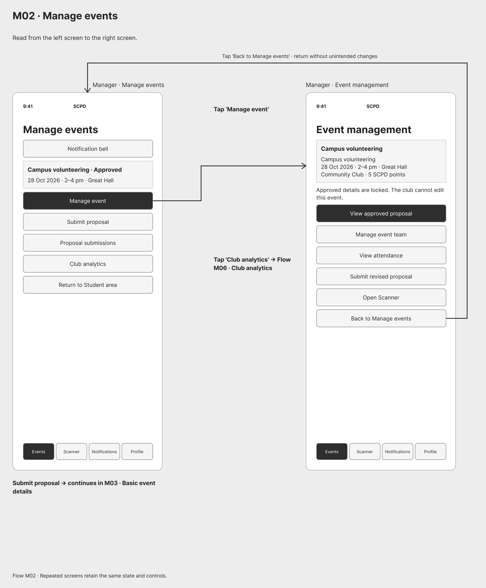](wireframes/images/18-M02-approved-event-locked.png)

Caption: R1 (C2, C5): An approved event is shown as locked, so the club cannot edit it and can only submit a revised proposal while the original stays active until it is approved.

### Figure 19 · M03 · Fill Basic event details

[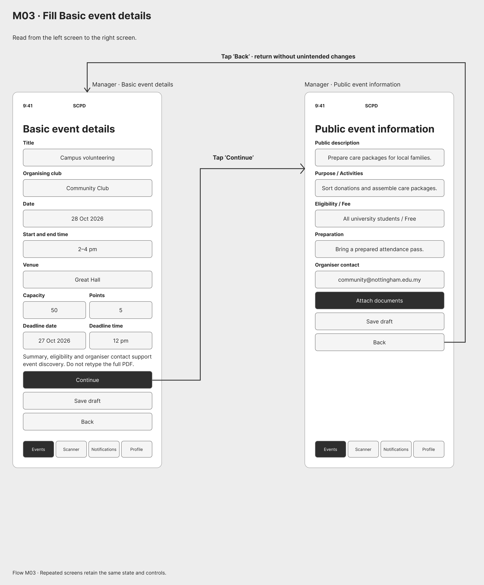](wireframes/images/19-M03-create-event-details.png)

Caption: R1 (C1): A club event manager creates an event by filling in event details, then continues to the public event information screen.

### Figure 20 · M04 · Review submission

[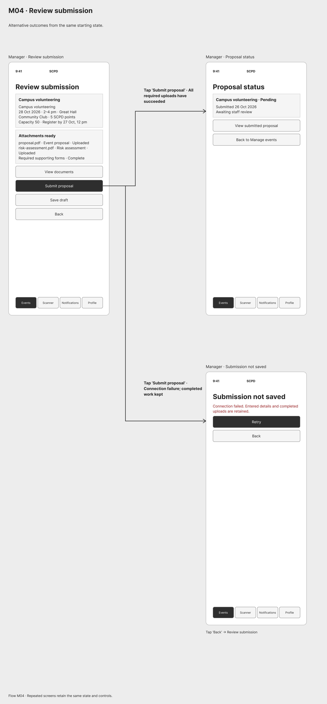](wireframes/images/20-M04-review-submission.png)

Caption: R1 (C1): Before submitting, the club event manager reviews the details and attached documents, and a failed submission keeps the entered details and uploads so nothing is lost.

### Figure 21 · M05.01 · Proposal status

[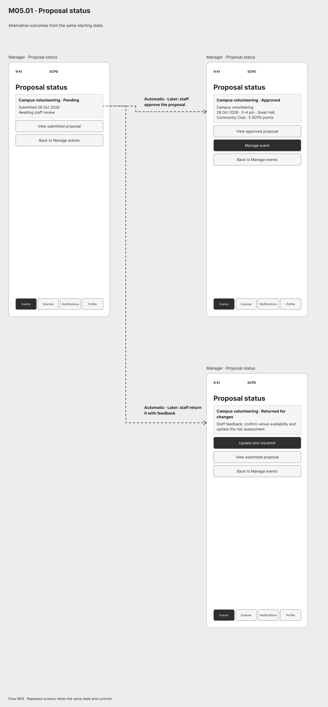](wireframes/images/21-M05.01-proposal-status.png)

Caption: R1 (C2, A1): The proposal status moves from Pending to Approved, after which students can find the event, or to Returned for changes with staff feedback and an option to correct and resubmit.

### Figure 22 · M05.02 · Proposal status

[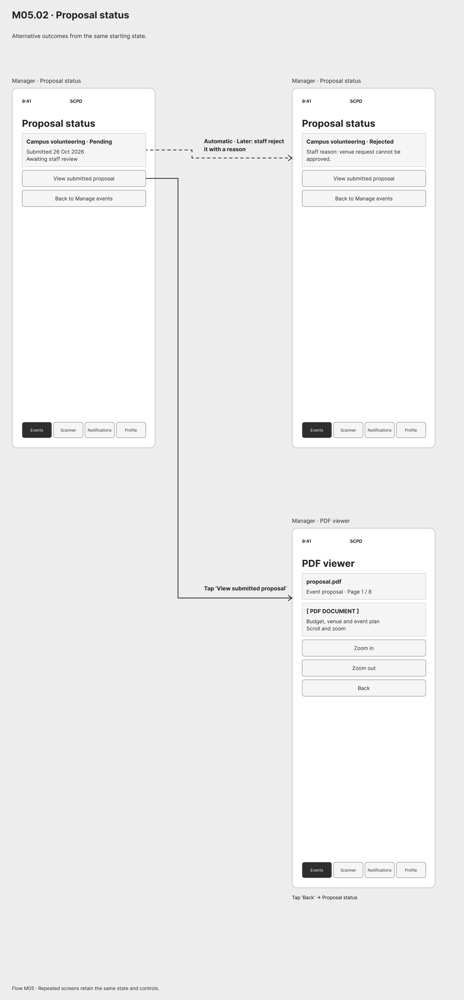](wireframes/images/22-M05.02-proposal-rejected.png)

Caption: R1 (C2, A1): A rejected proposal shows the staff's reason to the club, and the club event manager can still open the submitted proposal.

### Figure 23 · M06 · Club analytics

[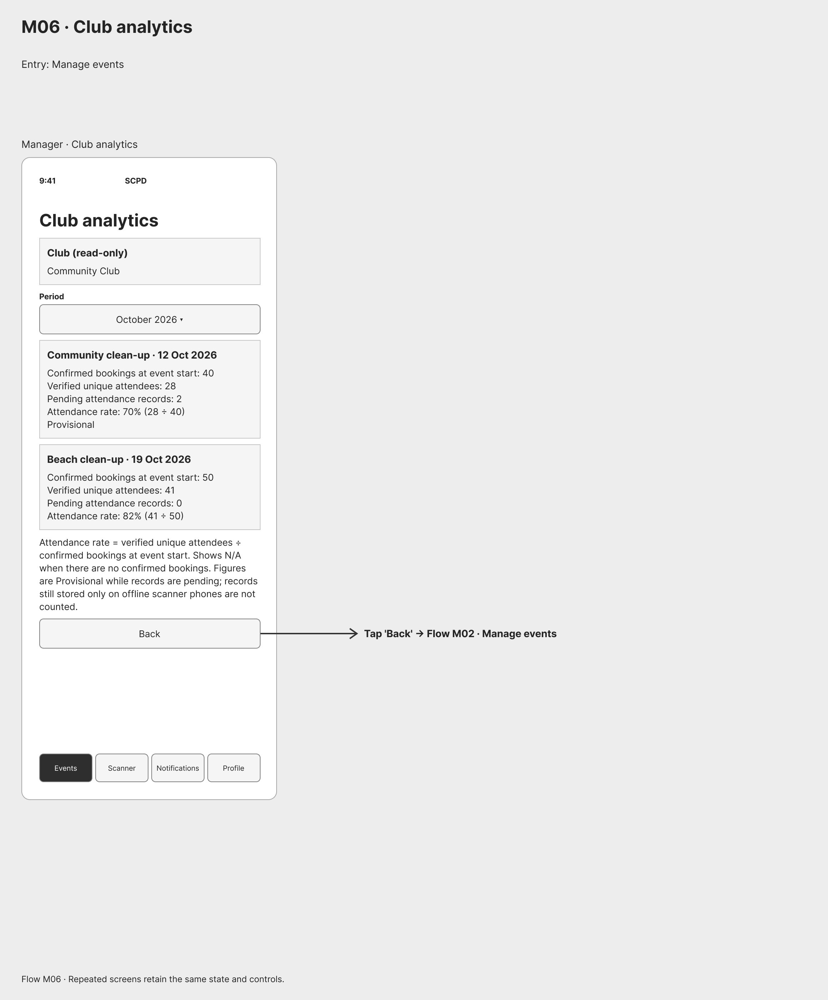](wireframes/images/23-M06-club-analytics.png)

Caption: Own feature 2 (C6): Club analytics shows each past event's confirmed bookings, verified attendees, pending records and attendance rate to the club's managers only.

### Figure 24 · M07 · Request event change

[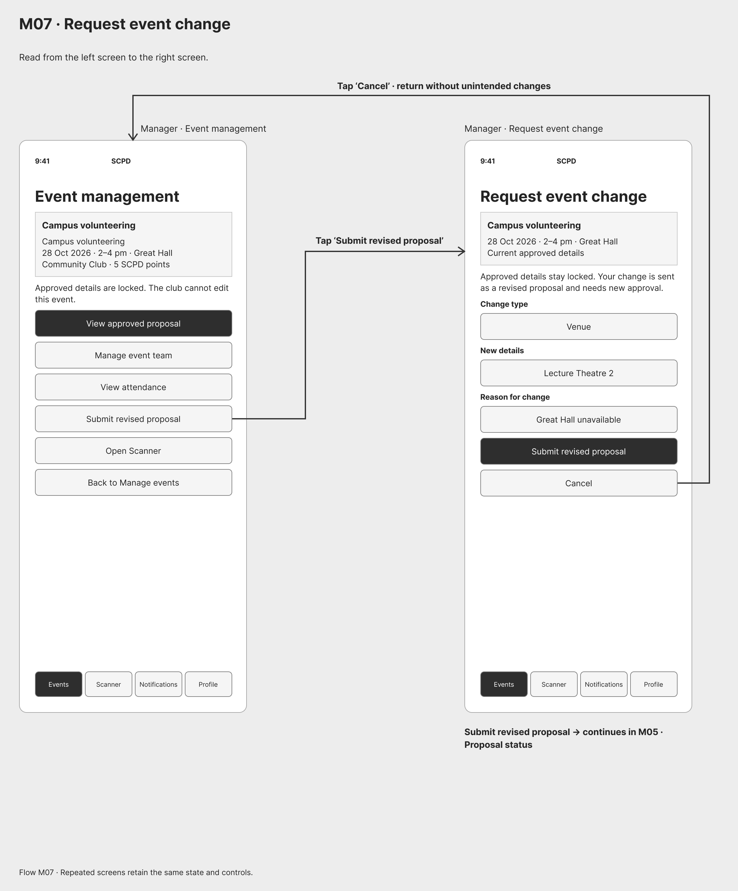](wireframes/images/24-M07-request-event-change.png)

Caption: R1 (C5): Approved event details stay locked, so the club event manager requests a change by choosing the change type, entering the new details and a reason, and submitting a revised proposal for new approval while the original stays active.

### Figure 25 · M08 · Manage event team

[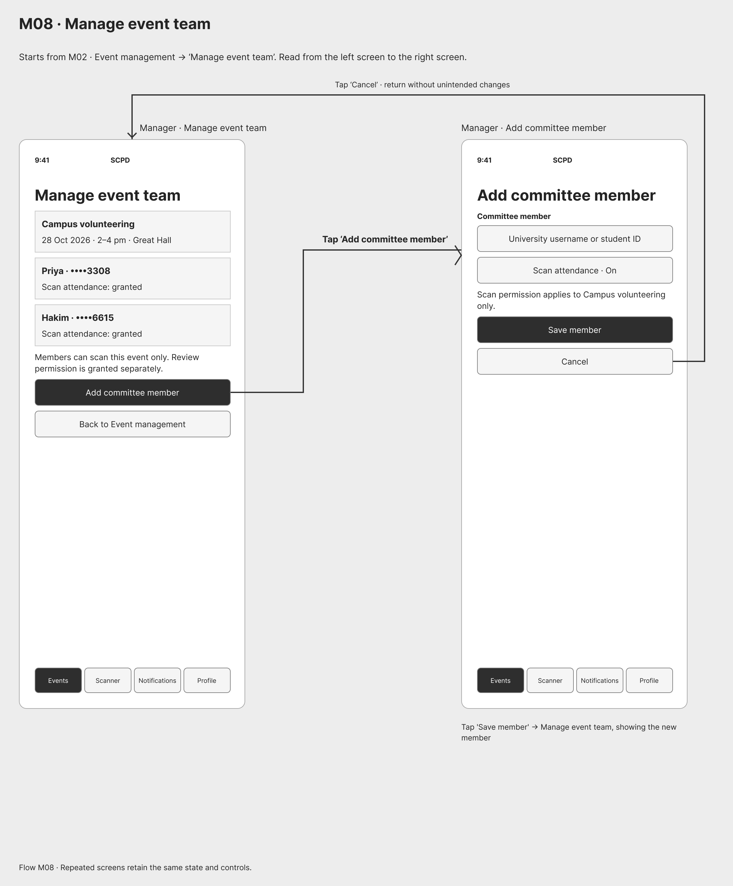](wireframes/images/25-M08-manage-event-team.png)

Caption: R6 (C3): The club event manager adds committee members by university username or student ID, and each member can scan attendance for this event only; review permission is granted separately.

## Committee scanner (Figures 26–30)

### Figure 26 · C01 · Scanner

Caption: R4 (C7): The committee scanner can start online scanning at once or enable offline scanning while connected, and it refuses with a clear message when there is no connection.

### Figure 27 · C02 · Scan attendance - Online

[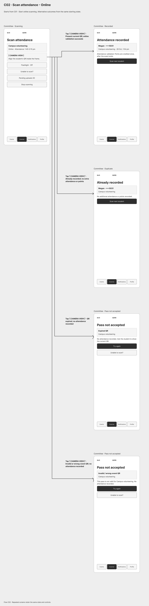](wireframes/images/27-C02-online-scanning.png)

Caption: R3 (C4, C8, S8): Online scanning checks the student's current attendance pass on the spot, records attendance once, shows "Already recorded" with no extra points on a repeat scan, and refuses an expired or wrong-event pass with a clear reason.

### Figure 28 · C03 · Scan attendance - Offline

Caption: R3, R4 (C7): Offline scanning checks the attendance pass against the data downloaded earlier and saves the attendance on the scanner as pending upload and verification, with no points awarded yet.

### Figure 29 · C04 · Request manual attendance review

[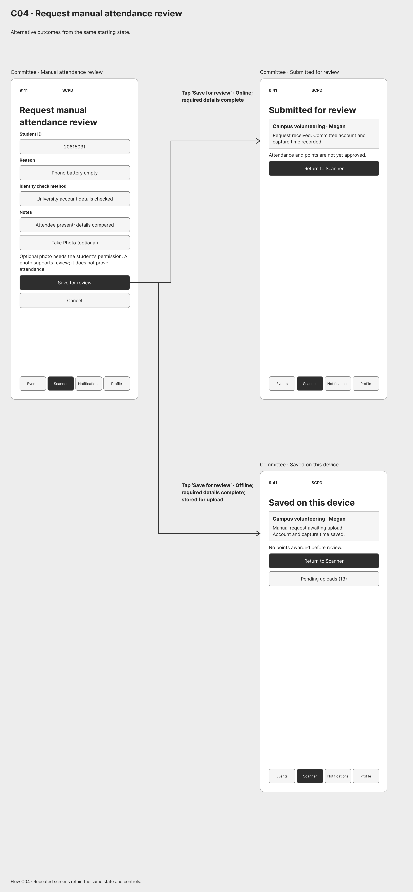](wireframes/images/29-C04-manual-attendance-request.png)

Caption: R3, R4 (C9): When a student cannot show a pass, the committee member records the reason and identity check in a manual attendance request, which is submitted if online or stored on the device if offline, and no points are given before review.

### Figure 30 · C05 · Pending uploads

Caption: R4 (C7, S10): Pending uploads lists the records saved on the scanner, uploads them by tap or automatically when connectivity returns, and then reports how many were validated, duplicate, rejected or awaiting review.

## Authorised reviewer (Figures 31–32)

### Figure 31 · R01 · Requests for review

Caption: R5, R6 (C10): Only an authorised reviewer can open the list of requests for review, where each pending manual request is shown before it is opened.

### Figure 32 · R02 · Review request

Caption: R5, R6 (C10, C11): The authorised reviewer records the evidence and reason and then confirms or rejects the attendance, with points credited once after the event ends only if it is confirmed, or escalates to Admin.
