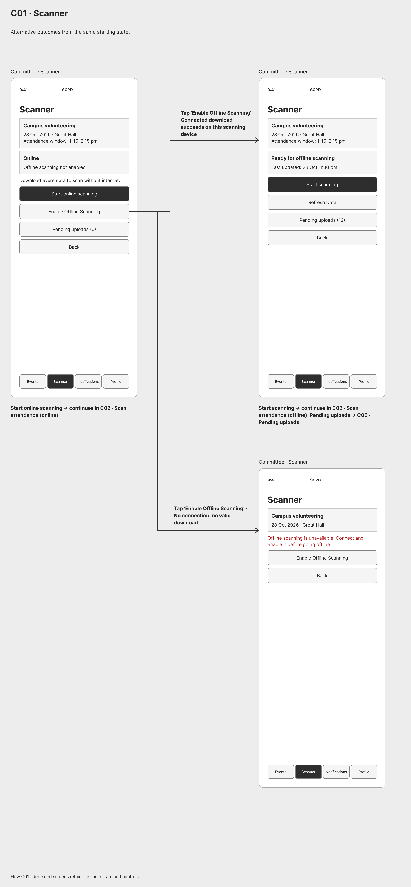
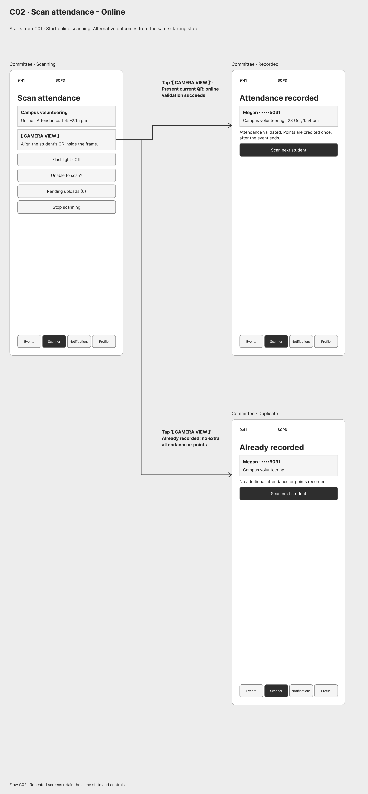
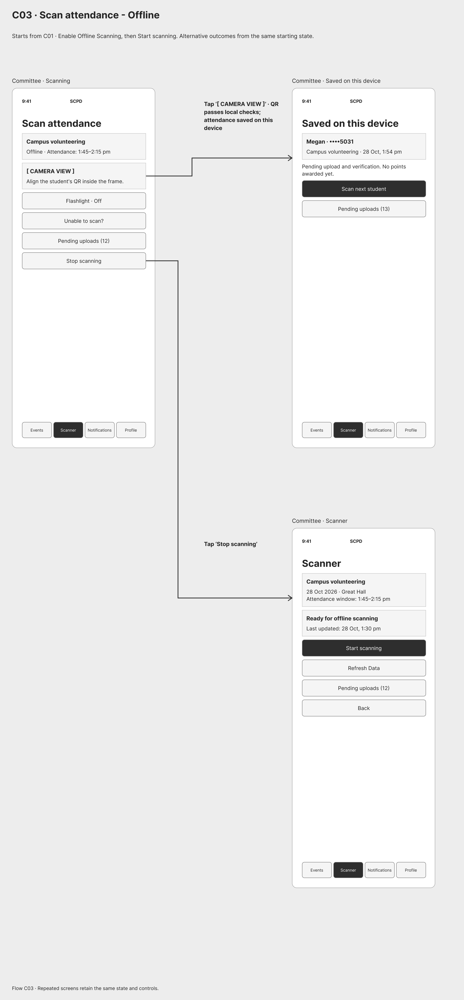
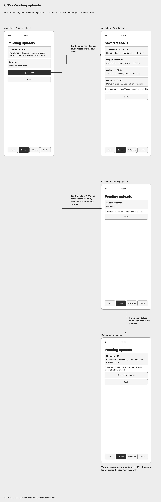
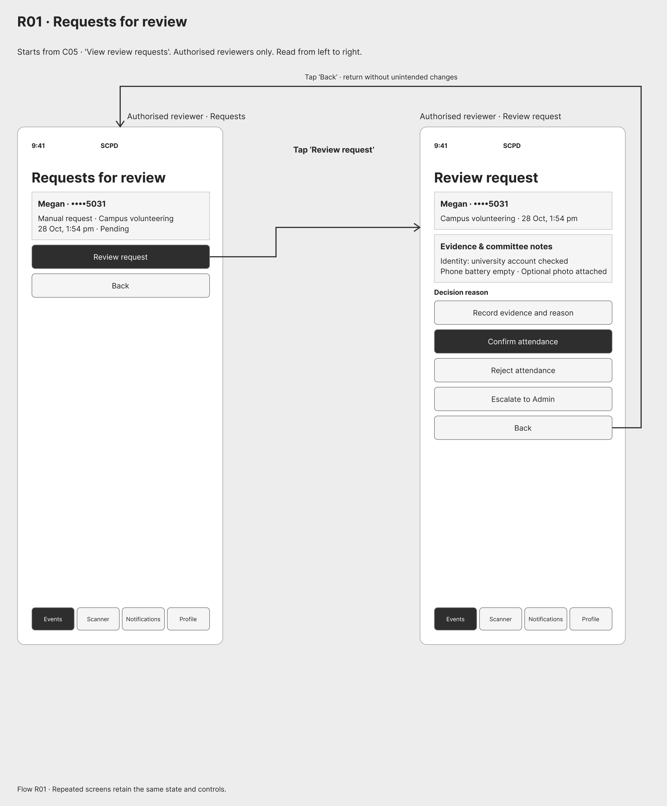
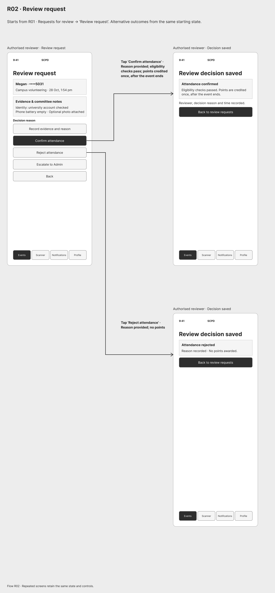

# s-CPD wireframes (Part 1)

Low-fidelity wireflows for the student, club event manager, committee scanner and authorised reviewer. Admin approves or rejects proposals directly in the backend database, so there are no Admin app screens.

Click an image to view it at full size.

| Figure | Panel | Title | Requirement | Image |
| --- | --- | --- | --- | --- |
| 01 | Legend | Legend | - | [Figure 01](images/01-legend.png) |
| 02 | S01 | University sign in: failed attempt, then success | R6 | [Figure 02](images/02-S01-sign-in.png) |
| 03 | S02.01 | Discover events: filter or view an event | R2 | [Figure 03](images/03-S02.01-discover-filter.png) |
| 04 | S02.02 | Discover events: no results for a search | R2 | [Figure 04](images/04-S02.02-no-results.png) |
| 05 | S03 | Book a place on Event details - Available | R2 | [Figure 05](images/05-S03-event-details-booking.png) |
| 06 | S04 | Booking clash | R2 | [Figure 06](images/06-S04-booking-clash.png) |
| 07 | S05 | Cancel booking | R2 | [Figure 07](images/07-S05-cancel-booking.png) |
| 08 | S06 | Event details - Join Waiting List | R2 | [Figure 08](images/08-S06-join-waiting-list.png) |
| 09 | S07 | Accept the offer: place confirmed, or clash | R2 | [Figure 09](images/09-S07-accept-offer.png) |
| 10 | S08.01 | Download the attendance pass: online or offline | R3 R4 | [Figure 10](images/10-S08.01-download-attendance-pass.png) |
| 11 | S08.02 | Open the attendance pass | R3 R4 | [Figure 11](images/11-S08.02-open-attendance-pass.png) |
| 12 | S08.03 | Attendance pass - Rotation Time | R3 R4 | [Figure 12](images/12-S08.03-qr-rotation.png) |
| 13 | S09.01 | My SCPD points | R5 | [Figure 13](images/13-S09.01-my-points.png) |
| 14 | S09.02 | Attendance status - Outcomes after scanning | R4 R5 | [Figure 14](images/14-S09.02-attendance-status.png) |
| 15 | S10 | Notifications | own feature 1 | [Figure 15](images/15-S10-reminder-notification.png) |
| 16 | S11 | Notification preferences | own feature 1 | [Figure 16](images/16-S11-reminder-preferences.png) |
| 17 | M01 | Profile & settings | R6 | [Figure 17](images/17-M01-role-based-entry.png) |
| 18 | M02 | Manage events | R1 (approved events are locked) | [Figure 18](images/18-M02-approved-event-locked.png) |
| 19 | M03 | Fill Basic event details | R1 | [Figure 19](images/19-M03-create-event-details.png) |
| 20 | M04 | Review submission | R1 | [Figure 20](images/20-M04-review-submission.png) |
| 21 | M05.01 | Proposal status | R1 | [Figure 21](images/21-M05.01-proposal-status.png) |
| 22 | M05.02 | Proposal status | R1 | [Figure 22](images/22-M05.02-proposal-rejected.png) |
| 23 | M06 | Club analytics | own feature 2 | [Figure 23](images/23-M06-club-analytics.png) |
| 24 | C01 | Scanner | R4 | [Figure 24](images/24-C01-enable-offline-scanning.png) |
| 25 | C02 | Scan attendance - Online | R3 | [Figure 25](images/25-C02-online-scanning.png) |
| 26 | C03 | Scan attendance - Offline | R4 | [Figure 26](images/26-C03-offline-scanning.png) |
| 27 | C04 | Request manual attendance review | R3 R4 | [Figure 27](images/27-C04-manual-attendance-request.png) |
| 28 | C05 | Pending uploads | R4 R5 | [Figure 28](images/28-C05-pending-uploads.png) |
| 29 | R01 | Requests for review | R5 R6 | [Figure 29](images/29-R01-requests-for-review.png) |
| 30 | R02 | Review request | R5 R6 | [Figure 30](images/30-R02-review-request.png) |

## Figure 01 · Legend · Legend

Caption: TODO

## Figure 02 · S01 · University sign in: failed attempt, then success

Caption: TODO

## Figure 03 · S02.01 · Discover events: filter or view an event

Caption: TODO

## Figure 04 · S02.02 · Discover events: no results for a search

Caption: TODO

## Figure 05 · S03 · Book a place on Event details - Available

Caption: TODO

## Figure 06 · S04 · Booking clash

Caption: TODO

## Figure 07 · S05 · Cancel booking

Caption: TODO

## Figure 08 · S06 · Event details - Join Waiting List

Caption: TODO

## Figure 09 · S07 · Accept the offer: place confirmed, or clash

Caption: TODO

## Figure 10 · S08.01 · Download the attendance pass: online or offline

Caption: TODO

## Figure 11 · S08.02 · Open the attendance pass

Caption: TODO

## Figure 12 · S08.03 · Attendance pass - Rotation Time

Caption: TODO

## Figure 13 · S09.01 · My SCPD points

Caption: TODO

## Figure 14 · S09.02 · Attendance status - Outcomes after scanning

Caption: TODO

## Figure 15 · S10 · Notifications

Caption: TODO

## Figure 16 · S11 · Notification preferences

Caption: TODO

## Figure 17 · M01 · Profile & settings

Caption: TODO

## Figure 18 · M02 · Manage events

Caption: TODO

## Figure 19 · M03 · Fill Basic event details

Caption: TODO

## Figure 20 · M04 · Review submission

Caption: TODO

## Figure 21 · M05.01 · Proposal status

Caption: TODO

## Figure 22 · M05.02 · Proposal status

Caption: TODO

## Figure 23 · M06 · Club analytics

Caption: TODO

## Figure 24 · C01 · Scanner

Caption: TODO

## Figure 25 · C02 · Scan attendance - Online

Caption: TODO

## Figure 26 · C03 · Scan attendance - Offline

Caption: TODO

## Figure 27 · C04 · Request manual attendance review

Caption: TODO

## Figure 28 · C05 · Pending uploads

Caption: TODO

## Figure 29 · R01 · Requests for review

Caption: TODO

## Figure 30 · R02 · Review request

Caption: TODO
